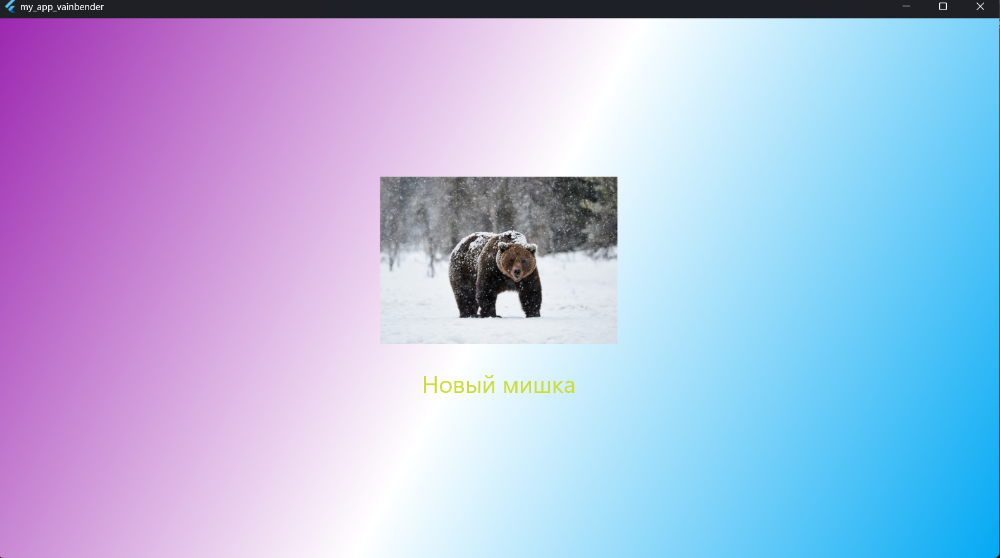

# Лабораторная работа №6. Flutter: самостоятельное приложение

**Автор: Иванов Иван, группа ИС-241, дата сдачи: 15.10.2026**
**Тема: Приложение показывает рандомную картинку медведя при нажатии на кнопку**

## Стек и версии
* Flutter 3.47.4
* Dart 3.13.3
* Платформа: Windows
* IDE: VS Code

## Скриншот приложения

## Структура проекта
* `lib/main.dart` — точка входа, настройка `MaterialApp` и `Scaffold`.
* `lib/gradient_container.dart` — `StatelessWidget` для градиентного фона. Принимает три цвета через конструктор.
* `lib/bear.dart` — `StatelessWidget` для отображения картинки. Принимает путь к изображению через конструктор.
* `lib/bear_roller.dart` — `StatefulWidget` с логикой случайного выбора картинки и кнопкой.

## Как запустить
1. git clone <https://github.com/ArtemVay/Flutter_Lab5.git>
2. cd <Documents/Flutter/ma_app_vainbender>
3. flutter pub get
4. flutter run -d windows

## Что изучили
1. Закрепили создание собственных виджетов и разбивку их по отдельным файлам.
2. Научились передавать данные через конструктор в `StatelessWidget`.
3. Повторили работу с состоянием через `StatefulWidget` и `setState()`.
4. Закрепили работу с ассетами (`assets`) и генерацией случайных чисел.
5. Отработали построение дерева виджетов.

## Ответы на вопросы

Не нашёл их